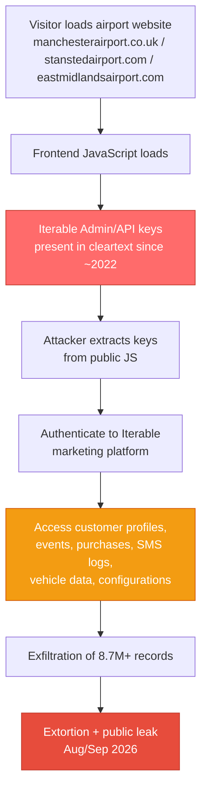

# The Soft Underbelly of Aviation
## Client-Side Secrets, Marketing Platforms and Third-Party Risk in European Airports (2022–2026)

**Independent OSINT Analysis – Prevention Focused**  
**Date**: 28 October 2026  
**Classification**: TLP:CLEAR  
**Author**: Independent OSINT researcher

---

### Executive Summary

While European airports have significantly hardened core operational systems after the September 2025 Collins Aerospace MUSE ransomware incident, a parallel and largely unaddressed risk surface remains wide open: **client-side secrets and third-party marketing / passenger ancillary platforms**.

The August 2026 Manchester Airports Group (MAG) breach provides the clearest public case study. FulcrumSec gained access through **admin-level Iterable API keys that had been hardcoded in the frontend JavaScript of the three MAG airport websites (Manchester, Stansted, East Midlands) since at least 2022** — nearly four years of continuous exposure.

This report reconstructs the vector, analyses the systemic pattern, connects it to the concurrent expansion of Amadeus biometric systems, provides a risk scorecard for major European airports, and delivers concrete prevention measures.

---

### 1. The MAG Breach Vector – Reconstructed

**Confirmed public elements:**

- MAG disclosed unauthorized access on 27 August 2026 affecting customer data from Wi-Fi registrations, car park, lounge and Fast Track bookings.
- FulcrumSec claimed responsibility and later leaked ~550 GB (claimed) covering approximately 8.7–8.8 million records.
- Multiple independent sources (SecurityWeek, The Register, Scott Helme analysis, Have I Been Pwned) confirmed that the initial access vector was **admin keys for the Iterable marketing automation platform left in plaintext inside the public JavaScript of the three airport root domains**.

**Key technical insight:**

These were not temporary debug keys. They remained present and functional for years. Iterable keys of this type typically allow broad read (and in some configurations write) access to customer profiles, event streams, purchase history, messaging logs and marketing configuration.

This is a classic **client-side secret anti-pattern**: credentials that belong exclusively on the server side were shipped to every visitor’s browser.

**Impact summary:**
- 8.7M+ customer profiles
- Purchase and booking histories
- Vehicle registration plates
- Browser / device / geolocation data
- SMS and engagement event logs
- No confirmed payment card data or operational flight systems compromised

---

### 2. Attack Path Diagram

---

### 3. Why This Matters More Than the Data Leak Itself

The operational systems (check-in, boarding, baggage, ATC interfaces) of major European airports have received intense attention and investment after Collins MUSE. The MAG case demonstrates that the real residual risk has migrated to the **ancillary layer**:

| Layer | Hardening Level (2026) | Attractiveness to Attackers | Example |
|-------|------------------------|-----------------------------|---------|
| Core operational (MUSE, DCS, AODB) | High | High impact, high difficulty | Collins 2025 |
| Border / biometric | Rising rapidly | High value identity data | Amadeus Seamless Gates |
| Marketing & CRM platforms | Low–Medium | High volume PII, low difficulty | Iterable at MAG |
| Passenger ancillary (WiFi, parking, lounge) | Medium | Medium–High | MAG systems |
| RMM / remote management | Variable | Very High (initial access) | SimpleHelp, FortiClient EMS |

Attackers have rationally shifted toward the soft underbelly.

---

### 4. The Amadeus Overlap – Emerging Convergence Risk

As of October 2026, Amadeus is rolling out **Seamless Gates** biometric border technology across 13 UK international airports, including Manchester, London Stansted and East Midlands (exactly the MAG airports).

Marketing platforms already hold rich behavioural and identity-linked data. Biometric systems add high-assurance identity anchors. The combination creates a high-value target surface if the ancillary systems remain weakly protected.

---

### 5. Risk Scorecard – Selected European Airports / Groups (Indicative)

Scoring is qualitative and based on publicly known technology footprints, past incidents and platform concentration risk. Scale 1–5 (5 = highest residual risk on ancillary/third-party layer).

| Airport / Group | Country | Known Platforms | Past Relevant Incidents | Ancillary / Marketing Risk | Notes |
|-----------------|---------|-----------------|-------------------------|----------------------------|-------|
| Manchester Airports Group (MAN, STN, EMA) | UK | Iterable (confirmed), Amadeus biometric rollout | FulcrumSec 2026 | **5** | Proven client-side key exposure |
| Heathrow | UK | Amadeus, multiple vendors | Collins MUSE impact 2025 | 4 | High volume + complex vendor mix |
| Brussels Airport | BE | Collins MUSE historically | Collins MUSE 2025 | 4 | Shared platform history |
| Berlin Brandenburg | DE | Collins MUSE historically | Collins MUSE 2025 | 4 | Shared platform history |
| Schiphol Group | NL | Multiple (Amadeus strong presence) | — | 3 | Mature but large attack surface |
| Aéroports de Paris (CDG, ORY) | FR | Amadeus, local systems | — | 3 | High traffic, complex ecosystem |
| Fiumicino / SEA Milan | IT | Mixed | — | 3 | Growing digitalisation |
| Dublin / Cork | IE | Collins impact 2025 | Collins MUSE 2025 | 4 | Shared platform exposure |

**Interpretation**: Airports that still rely on shared operational platforms *and* have not audited client-side secrets / marketing clouds remain at elevated residual risk even if core systems are hardened.

---

### 6. Technical Appendix – Iterable Keys & Client-Side Secrets

**What an Iterable API key typically grants**
- Read access to user profiles, email/SMS histories, purchase events, custom fields
- In many configurations, write/update capabilities and list management
- Ability to pull large datasets via API without further authentication once the key is obtained

**Why keys end up in frontend JavaScript**
- Developers embed keys for client-side tracking, personalisation or form submissions
- “It works” pressure + lack of secret scanning in CI/CD for public assets
- Keys intended as “public” are sometimes given elevated scopes by mistake

**Detection methods (defensive)**
1. Automated scanning of all public JS bundles and source maps for patterns matching known marketing platforms (Iterable, Segment, Braze, Salesforce Marketing Cloud, HubSpot, etc.).
2. Browser developer tools → Sources / Network → search for API keys or tokens.
3. Historical Wayback Machine / archived JS to determine exposure duration.
4. Content Security Policy reporting and subresource integrity checks.

**Prevention rules of thumb**
- No long-lived secret of any kind should ever be shipped to the browser.
- All sensitive API calls must be proxied through a backend that holds the real credentials.
- Rotate any key that has ever appeared in public JavaScript — treat it as compromised.
- Apply the same secret-management standards used for operational systems to marketing and analytics platforms.

---

### 7. Systemic Pattern Across 2025–2026

Three recurring failure modes:

1. **Shared operational platforms** (Collins MUSE) → single point of failure.
2. **Long-lived client-side secrets** (MAG Iterable keys) → trivial initial access lasting years.
3. **Exposed RMM tools** (SimpleHelp, FortiClient EMS – Phantom/INC campaign) → scalable initial access.

In all cases core flight operations were not the primary casualty. Damage occurred in supporting digital infrastructure treated as secondary.

---

### 8. Prevention Checklist for Airport Operators & Vendors

**Immediate (0–30 days)**
- [ ] Full audit of every public JavaScript file and source map for API keys / tokens
- [ ] Inventory of all third-party platforms processing passenger data (marketing, WiFi, parking, lounge, CRM)
- [ ] Rotation of any key that has ever been present in client-side code
- [ ] Review of Iterable / equivalent platform permission scopes (least privilege)

**Short term (1–3 months)**
- [ ] Move all sensitive API interactions server-side
- [ ] Implement strict CSP and SRI where applicable
- [ ] Segment marketing / ancillary environments from operational and biometric systems
- [ ] Add secret scanning to CI/CD pipelines for frontend assets

**Structural**
- [ ] Treat marketing automation platforms with the same security requirements as passenger processing systems
- [ ] Maintain a living third-party risk register that includes non-operational vendors
- [ ] Regular external reviews of public-facing assets specifically for client-side secrets
- [ ] Include ancillary systems in tabletop exercises and incident response plans

---

### 9. Conclusion

The Collins Aerospace incident of 2025 forced European aviation to confront the danger of shared operational platforms.  
The MAG breach of 2026 should force a second realisation: **the soft underbelly is no longer the check-in desk — it is the JavaScript on the airport website and the marketing cloud behind it**.

Until airports apply the same rigour to their ancillary and customer-data platforms that they now apply to passenger processing systems, high-volume, low-difficulty breaches of this type will continue.

This analysis is published to support prevention.

---

### Sources & References

- MAG official disclosure (27 Aug 2026)
- FulcrumSec leak-site claims and media relay (SecurityWeek, Computer Weekly, Hackread, Breached.Company)
- Scott Helme / The Register analysis of Iterable keys in frontend JS
- Have I Been Pwned confirmation of dataset contents
- Amadeus Seamless Gates rollout announcements (October 2026) covering the 13 UK airports including MAG sites
- Prior Collins Aerospace MUSE incident reporting (ENISA, RTX, NCA)
- SOCRadar Phantom/INC infrastructure research (for RMM parallel)

*This analysis is based exclusively on publicly available information and is intended for defensive research and prevention purposes.*
